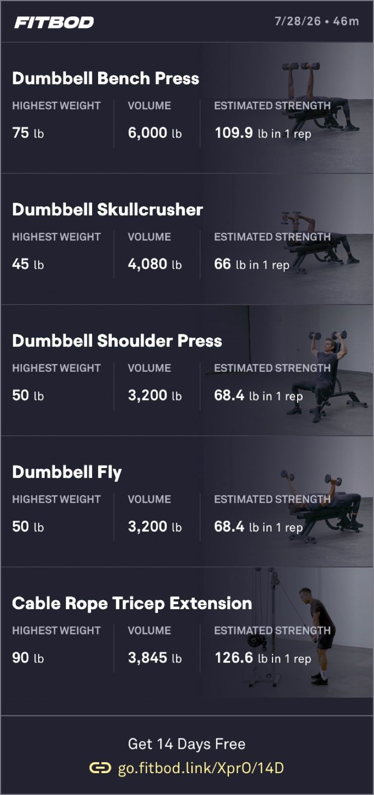

My legs are getting sorer by the minute from yesterday but still no Achilles pain so that is a major win. Chest today was difficult only because I haven’t done it in a while with so much busyness. Im excited to get a bit back more in the habit.

Unknown location (probably inside)
