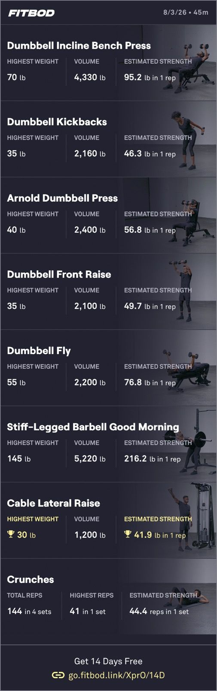

I ran into my personal trainer from when I first started at this new gym and caught him up on the last few months of life. As I explained my Achilles diagnosis and rehab journey, I realized that I had zero pain at all for the last few days. I had to step back a moment in quiet happiness.

Unknown location (probably inside)
