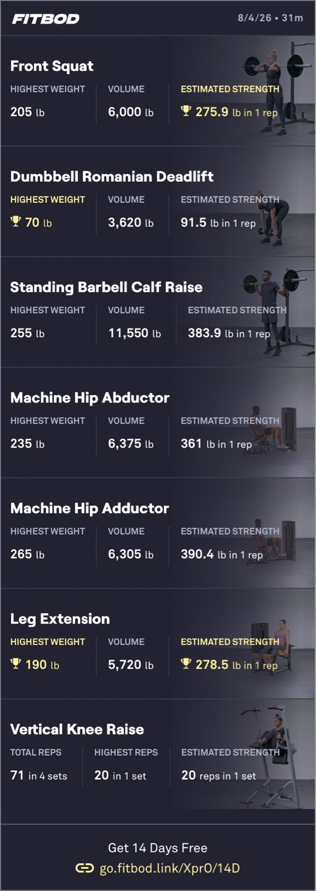

This was short because I had to take a cat to the vet but *damn* did this feel like a good strong stretch of my legs. I can feel them regaining strength. No pain.

Unknown location (probably inside)
