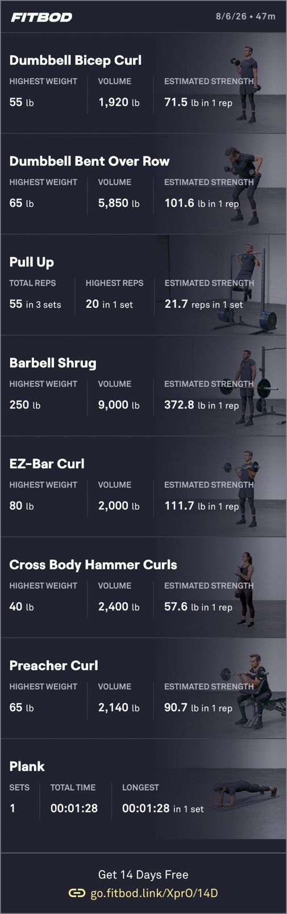

This fell short of the goals set by my Fitbod program. But I went as far as I could in this shortened time and hopefully I’ll be good and sore tomorrow and come back stronger.

Unknown location (probably inside)
