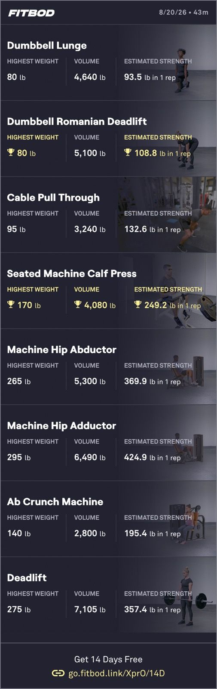

All the squat racks were taken when I arrived so instead I stepped up to some heavy lunges. Mostly that just tired my forearms. It felt good to deadlift at the end, though. Hadn’t done that in a while.

Unknown location (probably inside)
