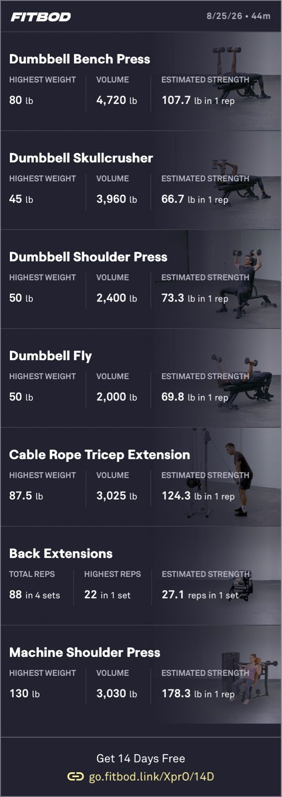

I think I might need to back off a bit. My right shoulder is slightly hurting like it did in the fall when I went too hard and had to have my scapula dry-needles to release the pent up lactic acid.

Unknown location (probably inside)
