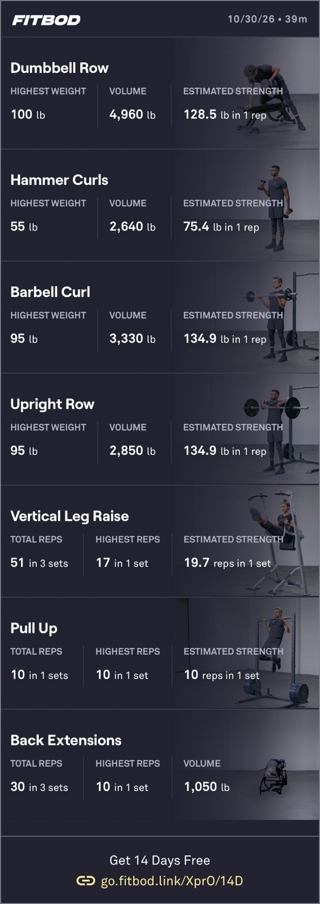

I hadn’t worked out since Monday due to some serious leg soreness after that last session. That and some late nights this week made this session difficult. 

I had to cut my pull-ups short due to pain in my lower lats on my left side. That’s not good. I wonder if it’s another deep lactic acid buildup like I had in my right shoulder last fall. That required deep needling to release.

Unknown location (probably inside)
