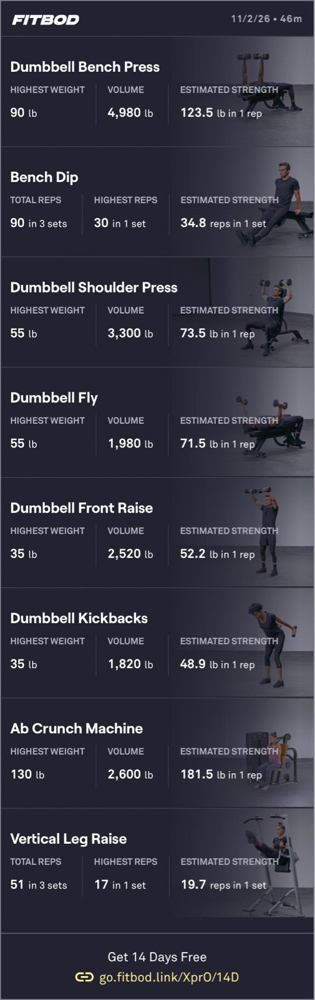

The bot had planned for me to do 10 reps each set in the first group but I got nowhere near. I think I’m seeing the effects of lifting less, still trying to have my body heal. 

My elbows both are twinged now on the medial dorsal part between my ulna and humerus. My right side even at rest, when I put pressure on it. But my left side was new today, painful when I was doing tricep kickbacks.

Unknown location (probably inside)
