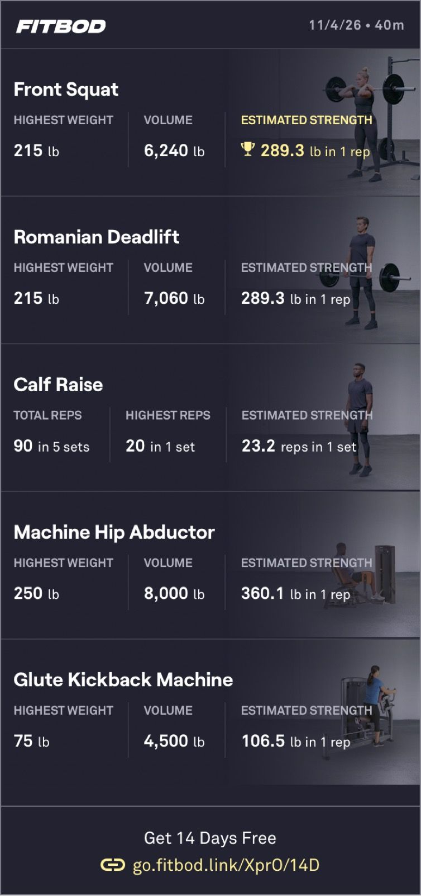

Adding in some calf raises because my bot coach is trying to coach me to get rid of my Achilles pain. The calf raises felt so good. 

Only pain today was some in my knees on the weight of the front squats, but most everything felt fine.

Unknown location (probably inside)
