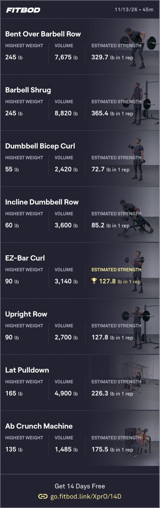

This didn’t go as long as I wanted but I had to work a bit later. I toned down the weight on the lat pulls by a couple dozen pounds because my left lat is still painful on those pull downs. Also I feel like these bicep curls are harder than they used to be. I guess I’m getting old.

Unknown location (probably inside)
